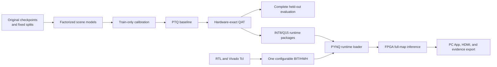

# Architecture

## End-to-end flow

## Programmable logic

Nine Verilog/SystemVerilog sources implement the runtime descriptor memory,
model memory, fixed-receiver cache, packed integer matrix operations, activation
pipeline, ray accumulation, and two-ray execution engine. Vivado Tcl creates the
Zynq block design, connects AXI DMA/GPIO/control infrastructure, builds the
bitstream, exports HWH metadata, and writes utilization and timing reports.

The design accepts scene-specific runtime packages. Switching a scene loads new
weights, descriptors, and fixed-receiver cache into the same hardware image.
The package identity therefore contains both a common bitstream hash and a
scene-specific runtime-model hash.

The Tcl target is 95 MHz. Archived matching HWH metadata records 94,117,645 Hz
(about 94.118 MHz), and the implemented clock period is 10.625 ns. Target and
implemented clock must be reported separately. The runtime weight memory has
3072 logical words of 1024 bits (128 INT8 weights per word), or 384 KiB.
AXI transport uses 64-bit transfers: sixteen transfers encode one weight word.
This PL limit is independent of SD-card capacity.

## Processing system

The ARM processor runs PYNQ Linux. Python uses `Overlay`, AXI DMA, and AXI GPIO
to configure and control the PL. The board service exposes health, scene,
benchmark, full-test, blind-query, arbitrary-Tx, HDMI, and evidence endpoints to
the PC application.

There is no bare-metal or FreeRTOS application. Consequently, the current
architecture does not need a Vitis platform or application project.

## Numeric contract

The network uses INT8 weights/activations, INT16 bias parameters, integer
accumulators, shifts and saturation. The ray renderer uses Q15 scaling and
returns uint32 raw amplitude values; Q15 does not imply a 16-bit output container.
Dividing raw output by 32768 gives normalized amplitude, not calibrated watts
or dBm. Fixed structural masks and QAT can change the original FP32 function;
removing grouped all-zero columns preserves the frozen integer function.
The QAT exporter models the same saturation, rounding, scaling, and packet
layout used by the runtime package and RTL. The ARM integer reference is used to
cross-check FPGA raw-Q15 output; a calibrated floating output is not substituted
for a physical raw result.

The HDMI path loads a PYNQ BaseOverlay after inference. It does not remain
resident in the inference bitstream; the next hardware request restores the
inference Overlay and associated runtime data. The 18 five-row base packets
are not 18 parallel engines. The current driver groups rows as 20,20,20,20,10;
the PL has two network ray lanes and a shared rendering path.

## Evidence boundaries

Four evidence layers are kept separate:

1. source and input lineage;
2. software evaluation and RTL simulation;
3. physical FPGA execution;
4. external power measurement.

Advancing one layer does not prove the next layer. This separation is enforced
by distinct schemas, hashes, paths, and finalization gates.
